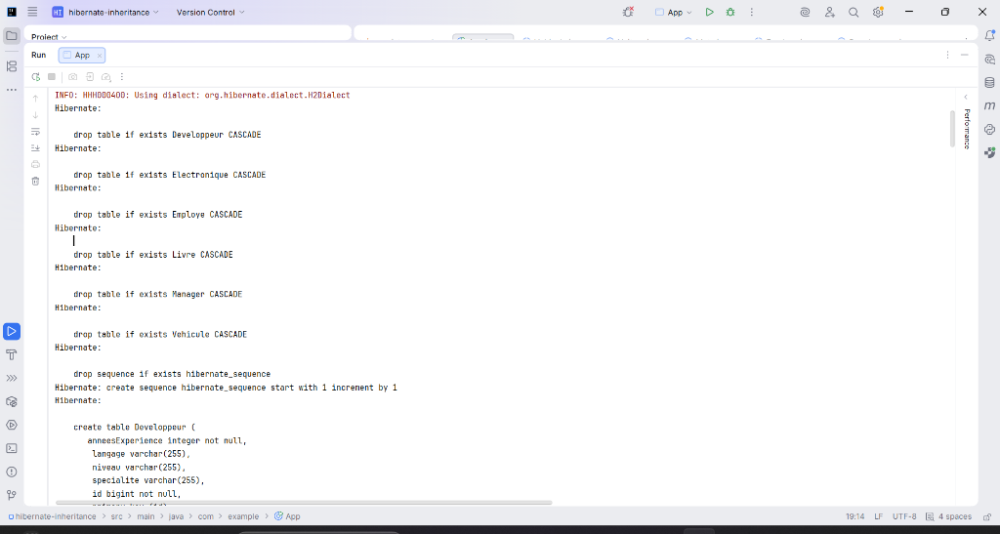
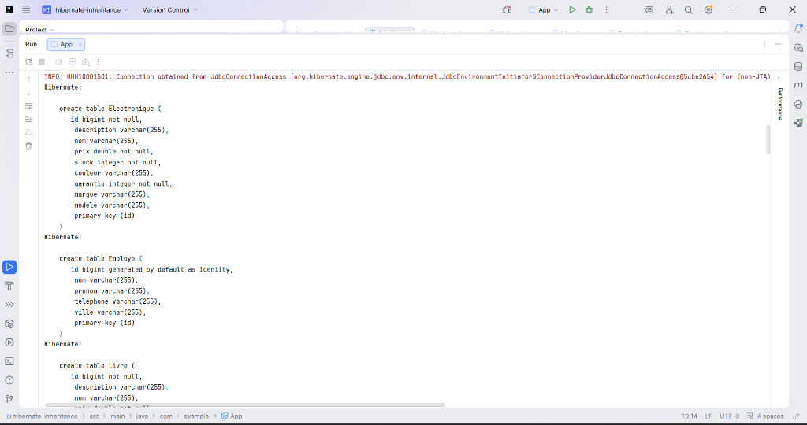
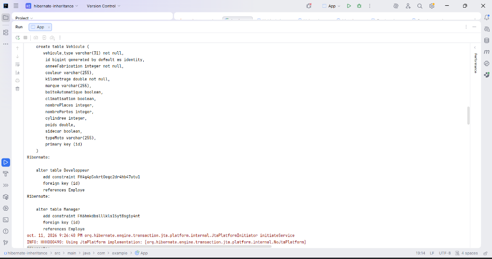
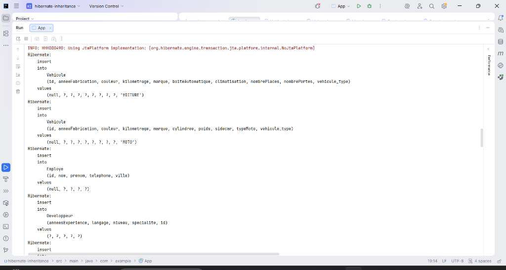
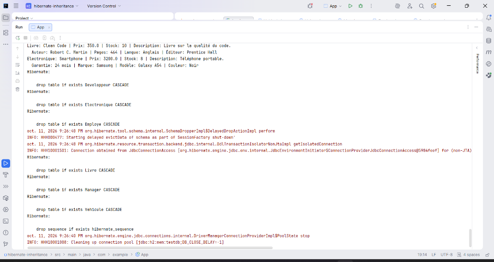

# Hibernate Inheritance Mapping - JPA

Ce projet illustre la mise en œuvre pratique des trois stratégies d'héritage objet-relationnel proposées par JPA / Hibernate :
- **SINGLE_TABLE** (Une seule table pour toute la hiérarchie de classes avec colonne discriminatrice)
- **JOINED** (Une table par classe avec jointure via clés étrangères)
- **TABLE_PER_CLASS** (Une table distincte par classe concrète contenant tous les attributs hérités)

---

## 1. Génération initiale du schéma de base de données (DDL)

Avant le démarrage des transactions, Hibernate initialise le schéma dans la base de données en mémoire H2 conformément à la configuration `create-drop`. Les tables existantes sont purgées (`DROP TABLE CASCADE`), puis la séquence et les premières tables sont créées.

---

## 2. Création des tables : Stratégies TABLE_PER_CLASS et JOINED

Dans cette phase, Hibernate génère :
- Les tables concrètes `Electronique` et `Livre` pour la stratégie **TABLE_PER_CLASS**, qui intègrent chacune l'ensemble des colonnes propres et héritées (la classe abstraite `Produit` ne génère pas de table).
- La table parente `Employe` pour la stratégie **JOINED**, contenant les colonnes communes de la hiérarchie des employés.

---

## 3. Création de la table SINGLE_TABLE et contraintes de clés étrangères

Cette étape montre :
- La création de la table unique `Vehicule` regroupant toutes les propriétés des classes `Voiture` et `Moto` ainsi que la colonne discriminatrice `vehicule_type`.
- La mise en place des contraintes d'intégrité référentielle (`FOREIGN KEY`) reliant les tables filles `Developpeur` et `Manager` à la table parente `Employe` pour la stratégie **JOINED**.

---

## 4. Insertion des données en base

Lors du `commit` de la transaction, Hibernate génère les requêtes `INSERT` adaptées à chaque stratégie :
- Pour `Vehicule` (**SINGLE_TABLE**), les insertions ciblent la même table en renseignant la valeur du discriminateur (`'VOITURE'`, `'MOTO'`).
- Pour les employés (**JOINED**), Hibernate scinde chaque persistance en deux requêtes : une première insertion dans la table parente `Employe` puis une seconde dans la table fille spécialisée (`Developpeur` ou `Manager`).

---

## 5. Lecture polymorphique, affichage console et fermeture

Après le vidage du contexte de persistance (`em.clear()`), les données sont rechargées depuis la base de données à l'aide de requêtes polymorphiques JPQL.
- La console affiche le détail complet des entités persistées (véhicules, employés et produits avec l'ensemble des propriétés ajoutées).
- À la fermeture de la `SessionFactory`, Hibernate procède au nettoyage automatique des structures (`drop table`) et à la libération des connexions du pool H2.

